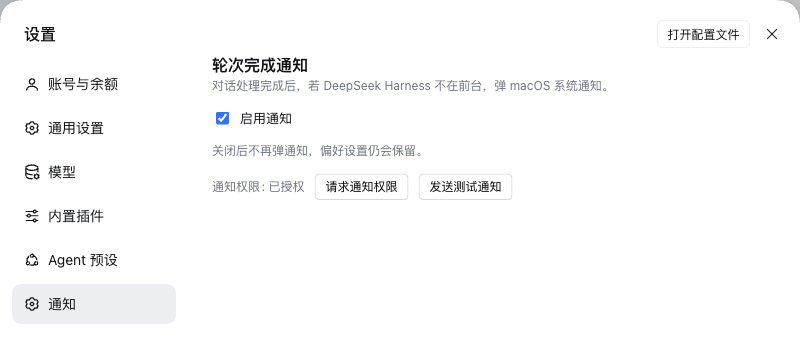
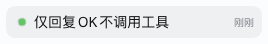

> **Archived / superseded.** This plugin is now part of
> [`@apodemakeles/dsh-kit`](https://github.com/apodemakeles/dsh-kit), which merges
> the token dashboard and turn notifications into one bundle. This repository is
> archived and no longer maintained.

# @apodemakeles/dsh-macos-notify

English | [中文](README.zh.md)

A DeepSeek Harness (DSH) plugin: when a conversation turn finishes while the harness window is not in the foreground, show a macOS system notification. It also leaves an in-app unread dot on sessions that finished while you were away.

> Status: **v0.1.2**, distributed from GitHub. The unscoped npm name `dsh-macos-notify` belongs to another package, so install this plugin from the `@apodemakeles` scope through GitHub.

## Screenshots

### Notification settings



### Unread completion dot



## What it does

| turn/end reason | notification |
|---|---|
| `completed`, `max-tokens`, `blocked` | title = session name, body = completed (localized) |
| `error` | title = session name, body = failed (localized) |
| `aborted`, `interrupted`, unknown | silent |
| subagent sessions | silent |

- Notifies only while the harness window is unfocused (`document.hasFocus() === false`).
- Clicking a notification focuses the window and opens that session.
- A completion while the window is unfocused also leaves a small unread dot on the session row, **even when the session stayed in the main view**. The dot is green for success and red for failure; it clears when you click the row, start another run, or click the notification. When the official UI already shows its own background-completion dot, this plugin does not add a second one.
- No history replay: the first projection value after startup or reconnect only seeds the baseline.
- **Settings → Notifications** has the master switch (default on), permission state, and request-permission / test-notification buttons. The switch is stored in the browser's localStorage.

## Install

### Desktop app

The `desktop` profile is managed by the Electron app, so `dsh plugin --profile desktop` is refused. Add the dependency and the bundle to the profile the same way the app's plugin manager does:

```bash
DSH_HOME=${DSH_HOME:-$HOME/.dsh}
PROFILE="$DSH_HOME/profiles/desktop"

pnpm --dir "$PROFILE" add github:apodemakeles/dsh-macos-notify
```

Then add `@apodemakeles/dsh-macos-notify` to `dsh.profile.bundles` in `$PROFILE/package.json`:

```json
{ "dsh": { "profile": { "bundles": [
  "@deepseek-ai/dsh-base",
  "@deepseek-ai/dsh-web-app",
  "@apodemakeles/dsh-macos-notify"
] } } }
```

Restart the app. **Plugins → Installed** lists the plugin, and **Settings → Notifications** shows the switch.

### Web profile

```bash
dsh plugin --profile web add github:apodemakeles/dsh-macos-notify
# restart dsh web
```

### Release tarball

Each GitHub release includes `apodemakeles-dsh-macos-notify-<version>.tgz`:

```bash
dsh plugin --profile web add file:/path/to/apodemakeles-dsh-macos-notify-0.1.2.tgz
```

## macOS notification permission

The first notification needs permission: click **Request permission** or **Send a test notification** in Settings → Notifications, then allow **DeepSeek Harness** in System Settings → Notifications.

A Focus mode can silently hold notifications (`delay delivery`) even when the app is allowed. Add DeepSeek Harness to that Focus mode's allowed apps, or turn the Focus mode off. The in-app unread dot is independent of Focus.

## How it works

- **Host half** (`src/index.ts`, `src/projection.ts`) registers a `turn-notify` session projection. It folds `turn/start` and `turn/end.reason` and exposes `{ turn, reason }` to the client. No webServer route, launch token, or Electron shell code.
- **Client half** (`src/client/index.ts`) watches the session list, detects a fresh projection turn, applies the master switch / subagent filter / reason mapping / focus gate, shows a browser `Notification`, and opens the session with `uiWorkspace.openSession(id)` on click. The unread dot is rendered through the official `sidebar.session.row.leading` slot, only while the official status dot is idle.
- The host bundles `zod` for the projection schema; React stays external in the client and comes from the shell's module table.
- No network requests: session names and turn reasons stay local.

## Compatibility

- DSH `0.2.x` (`engines.dsh`: `>=0.2.0-rc.1 <0.3.0`); tested with the desktop app `0.2.1-rc.2` and CLI `0.2.0-rc.1`.
- macOS for notifications (browser/Electron Notification API); the unread dot is platform-neutral.
- Node `>=22`.

## Development

```bash
git clone https://github.com/apodemakeles/dsh-macos-notify.git
cd dsh-macos-notify
pnpm install
pnpm typecheck
pnpm test
pnpm build
```

`pnpm build` produces:

- `lib/index.js` — host ESM; registers the projection.
- `lib/client.js` — browser CJS bundle wrapped in the `window.__ModuleLoader__.load` factory.
- `lib/types/**` — declaration files.

For local development, install the checkout into a profile with `dsh plugin --profile web add link:$(pwd)` (or the equivalent `pnpm --dir "$PROFILE" add link:$(pwd)` for the desktop profile).

## License

MIT
