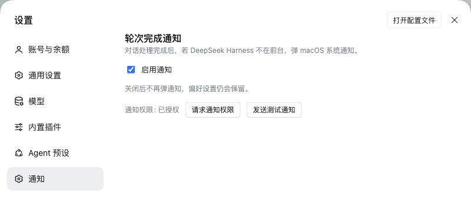
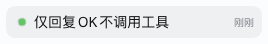

> **已归档 / 已被取代。** 本插件已并入
> [`@apodemakeles/dsh-kit`](https://github.com/apodemakeles/dsh-kit)（token 仪表盘与
> 轮次完成通知合并为一个 bundle）。本仓库已归档，不再维护。

# @apodemakeles/dsh-macos-notify

[English](README.md) | 中文

DeepSeek Harness（DSH）插件：每轮对话结束时，如果 Harness 窗口不在前台，弹一条 macOS 系统通知；同时给“完成时你不在电脑前”的会话留一个应用内未读绿点。

> 状态：**v0.1.2**，通过 GitHub 分发。npm 上未加 scope 的 `dsh-macos-notify` 已被别的包占用，所以本插件只从 `@apodemakeles` scope 经 GitHub 安装。

## 截图

### 通知设置



### 未读完成绿点



## 行为

| 结束原因 | 通知 |
|---|---|
| `completed`、`max-tokens`、`blocked` | 标题=会话名，正文「处理完成」 |
| `error` | 标题=会话名，正文「处理失败」 |
| `aborted`、`interrupted`、未知 | 静默 |
| 子代理会话 | 静默 |

- 只在该轮**不在前台焦点**时弹（`document.hasFocus() === false`）。
- 点击通知聚焦窗口并打开对应会话。
- 窗口失焦完成时，在会话行左侧留一个未读点（成功绿色、失败红色），**即使完成时你仍停在该会话**；点击该会话行、重新运行该会话或点击通知后清除。官方 UI 已显示自己的“后台会话完成”绿点时，本插件不重复渲染。
- 不补弹历史：插件启动或重连时第一次看到某会话的投影只建立基线。
- **设置 → 通知** 提供总开关（默认开启）、权限状态、请求权限和测试通知；开关存在浏览器 localStorage。

## 安装

### 官方桌面 App

`desktop` profile 由 Electron App 管理，`dsh plugin --profile desktop` 会被拒绝。按 App 插件管理器的方式把依赖和 bundle 加进 profile：

```bash
DSH_HOME=${DSH_HOME:-$HOME/.dsh}
PROFILE="$DSH_HOME/profiles/desktop"

pnpm --dir "$PROFILE" add github:apodemakeles/dsh-macos-notify
```

然后把 `@apodemakeles/dsh-macos-notify` 加进 `$PROFILE/package.json` 的 `dsh.profile.bundles`：

```json
{ "dsh": { "profile": { "bundles": [
  "@deepseek-ai/dsh-base",
  "@deepseek-ai/dsh-web-app",
  "@apodemakeles/dsh-macos-notify"
] } } }
```

重启 App。**插件 → 已安装** 会列出该插件，**设置 → 通知** 里能看到开关。

### Web profile

```bash
dsh plugin --profile web add github:apodemakeles/dsh-macos-notify
# 重启 dsh web
```

### Release tarball

每个 GitHub Release 附带 `apodemakeles-dsh-macos-notify-<version>.tgz`：

```bash
dsh plugin --profile web add file:/path/to/apodemakeles-dsh-macos-notify-0.1.2.tgz
```

## macOS 通知权限

首次通知需要授权：在 **设置 → 通知** 点「请求通知权限」或「发送测试通知」，然后到 **系统设置 → 通知 → DeepSeek Harness** 允许。

专注模式即使放行了 App 也可能把通知静音（`delay delivery`）。把 DeepSeek Harness 加进当前专注模式的「允许的 App」，或者关掉专注模式。应用内未读绿点不受专注模式影响。

## 实现

- **宿主半区**（`src/index.ts`、`src/projection.ts`）注册 `turn-notify` session projection，折 `turn/start` 与 `turn/end.reason`，把 `{ turn, reason }` 交给客户端。不再需要 webServer 路由、launch token 或 Electron 壳代码。
- **客户端半区**（`src/client/index.ts`）订阅 session list，比较 projection 的 `turn` 号判断新完成；应用总开关、子代理过滤、reason 映射和焦点闸门；用浏览器 `Notification` 发系统通知，点击时 `uiWorkspace.openSession(id)` 打开会话。未读绿点通过官方 `sidebar.session.row.leading` 槽位渲染，只在官方状态点缺席时出现。
- 宿主打包 `zod`（投影 schema）；客户端只外置 React，由壳的模块表提供。
- 没有网络请求：会话名和结束原因都留在本机。

## 兼容性

- DSH `0.2.x`（`engines.dsh`：`>=0.2.0-rc.1 <0.3.0`）；已在桌面 App `0.2.1-rc.2`、CLI `0.2.0-rc.1` 上验证。
- 通知面向 macOS（浏览器/Electron Notification API）；未读绿点与平台无关。
- Node `>=22`。

## 开发

```bash
git clone https://github.com/apodemakeles/dsh-macos-notify.git
cd dsh-macos-notify
pnpm install
pnpm typecheck
pnpm test
pnpm build
```

`pnpm build` 产出：

- `lib/index.js`——宿主 ESM，注册投影。
- `lib/client.js`——浏览器 CJS bundle，带 `window.__ModuleLoader__.load` 工厂包装。
- `lib/types/**`——类型声明。

本地开发可以 `dsh plugin --profile web add link:$(pwd)`（桌面 profile 则用 `pnpm --dir "$PROFILE" add link:$(pwd)`）。

## License

MIT
